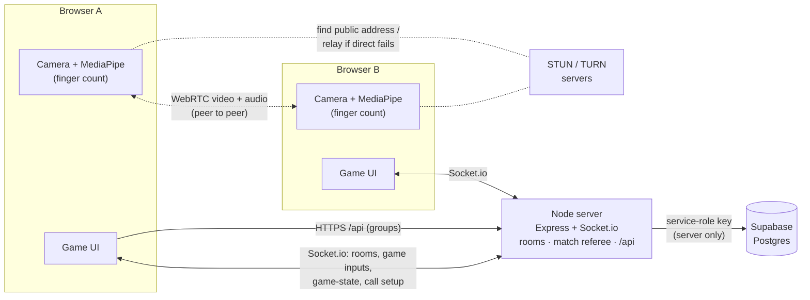
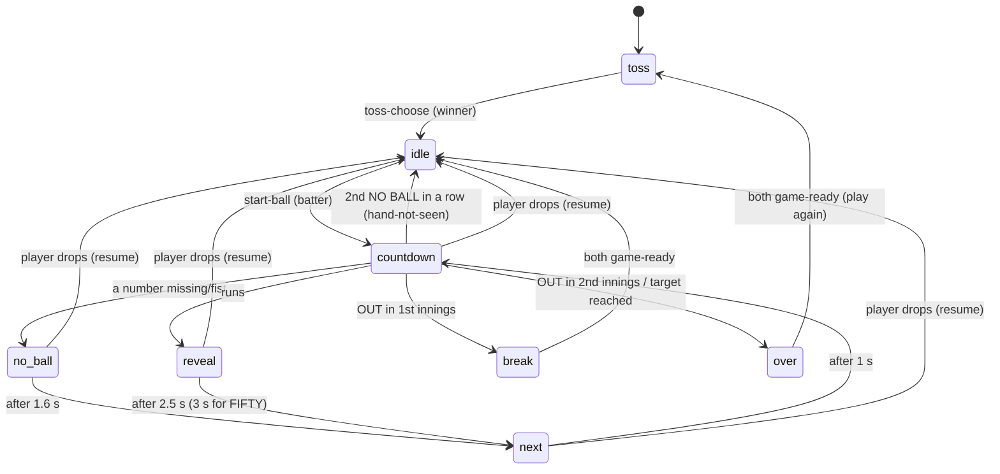

# Hand Cricket — System Design

How the app works, why it's built this way, what went wrong along the way, and how it would grow.
Written from the actual code and `DECISIONS.md`. Plain English; snippets only where they help.

---

## 1. Summary

Hand Cricket is a browser game where two friends play the playground game "hand cricket" over a live video call. Each player's webcam reads how many fingers they hold up (1–5, thumb only = 6), right in their own browser. The batter scores their number unless both show the same number, which means OUT. One wicket each, and the second batter chases the target.

There are three modes:
1. **Play the Computer** runs entirely in the browser against a random bot. It's good for practice and for testing the camera.
2. **Play a Friend** uses a room code or link, a live video and audio call, and a match refereed by the server.
3. **Groups + leaderboards** let friends form a group (like "CSE Gang"). Every friend match between two members counts on that group's THIS WEEK and ALL TIME boards, which are stored in Supabase.

---

## 2. Architecture



### Which traffic goes where

| Traffic | Path | Why |
|---|---|---|
| Room messages (create, join, ready) | Browser ↔ Socket.io ↔ server | The server owns rooms. |
| Game inputs (toss, start ball, my number, ready) | Browser → server | The server is the referee. |
| Game state (scores, phase, countdown time, reveal) | Server → both browsers (`game-state`) | Both screens show the same truth. |
| Call setup (offer, answer, ICE candidates) | Browser → server → other browser | Browsers can't find each other without a go-between. |
| **Video + audio** | **Browser ↔ browser directly** (WebRTC), via TURN only if a direct path fails | Fast, private, and free for us. |
| Groups and leaderboards | Browser → `/api` → server → Supabase | The secret DB key stays on the server. |
| Match results | Server → Supabase | Clients never send results. |
| Hand detection | Stays inside each browser | No video is ever uploaded. |

### Files and their jobs

**Server (project root)**

| File | Job |
|---|---|
| `server.js` | Starts Express and Socket.io. Wires room events, call-message relay, game inputs and `/api`, and creates and ends each room's match. |
| `rooms.js` | In-memory rooms: 4-letter codes, 2 players, ready flags, rejoin slots, version numbers, cleanup sweep. |
| `friend-game.js` | The match referee for one room: phases, toss, timers, numbers, presence/pause, snapshots. |
| `shared/rules.js` | Pure game rules (play a ball, OUT, chase finished, winner, 50-run milestone). Used by both server and browser. |
| `groups.js` | Group logic: create/join, invite codes, "my groups", leaderboard, saving matches with retries. |
| `leaderboard.js` | Pure leaderboard maths: Monday-in-Kolkata week, rank, win %, streak, "wins behind" line. |
| `stores.js` | Storage: `SupabaseStore` (real DB) and `MemoryStore` (when Supabase isn't configured). |
| `api.js` | The `/api` HTTP routes, error-to-status mapping, and "offline" replies. |
| `supabase/schema.sql` | Tables, indexes and RLS for Supabase. |

**Browser (`public/`)**

| File | Job |
|---|---|
| `index.html`, `home.js`, `home.css` | Home screen, name, Play a Friend, lobby, `?room=` and `?group=` links. |
| `home-groups.js` | The "My groups" panel: list with this week's standing, create, join. |
| `group.html`, `group.js` | Group page: invite link, THIS WEEK / ALL TIME table. |
| `computer.html`, `game.js` | The vs-computer game (all in the browser). |
| `friend.html`, `friend.js` | The friend screen: camera and mic, the WebRTC call, mic meters, dev mode. |
| `friend-match.js` | Draws the friend match from server snapshots, runs the synced countdown, sends inputs. |
| `match-ui.js` | Pieces shared by both modes: scoreboard, banners, toss/break/end panels, record, confetti, ball strip. |
| `hand.js` | Camera start-up and MediaPipe HandLandmarker; finger counting and smoothing. |
| `sounds.js`, `audio-levels.js` | Generated game sounds; mic level meter and the "talking" detector. |
| `api.js`, `player.js` | `/api` helper; this browser's player id, name and dev-mode flag. |
| `base.css`, `style.css` | Shared look; game screen layout. |

**Tests:** `test/*.test.js` (48 unit and server tests) and `e2e/*.mjs` (Playwright with two browser profiles: call, full match, groups).

---

## 3. Request flows (dry runs)

### 3.1 Create room → friend joins → both ready

1. **Asha** types her name and clicks **Play a Friend → Create room**. The browser sends `create-room { playerId, name, view: 'lobby' }`.
2. The server makes room `KBRX` (letters without I/L/O), puts Asha in slot 0, and replies with the room. It also broadcasts `room-update` with `version: 1`. Asha's URL becomes `/?room=KBRX`.
3. Asha shares the link. **Ravi** opens it, types his name, and sends `join-room { code: 'KBRX', playerId, name, view: 'lobby' }`.
4. The server puts Ravi in slot 1 and bumps the version. It broadcasts `room-update` to both, so Asha's lobby shows "Ravi".
5. Each presses Ready (button or Space) and sends `set-ready { ready: true }`.
6. When both are ready and connected, the server sets `room.stage = 'playing'`, creates a `FriendGame` for the room, and starts the toss. Both players are still on the lobby page, so the game starts **paused**.
7. Both lobbies get `room-update` with `stage: 'playing'`, show "Both ready! Starting…" for 0.9 s, and go to `/friend.html?room=KBRX`.
8. Each game page opens a new socket and sends `join-room { …, view: 'game' }`. The server marks that player present on the game screen. Once both are present, the game un-pauses and broadcasts `game-state`.

Every room snapshot carries a version number, and pages ignore anything older than what they've seen (see wall #4).

### 3.2 WebRTC call setup

1. Each game page asks for camera and mic (`getUserMedia`, 640×480, echo cancellation on). If the mic is blocked, it continues camera-only and shows "Mic blocked".
2. Each page loads `GET /ice`. That's Google STUN, plus TURN if `TURN_URL`, `TURN_USERNAME` and `TURN_CREDENTIAL` are set.
3. The page watches `room-update`. When the friend is connected **and on the game screen**, it builds a "friend key" (`playerId:session`). A new key means a new call.
4. **The player in slot 0 always makes the offer** (no glare). It creates an `RTCPeerConnection`, adds its camera and mic, makes a new `callId`, and sends `offer { callId, description }`.
5. The server relays it to the other player only (`peerSocketId`). The answerer applies the offer, adds its own tracks, and sends `answer { callId, description }`.
6. Both sides send their network candidates as `ice-candidate { callId, candidate }`:
   - **host**: the local address
   - **srflx**: the public address found via STUN
   - **relay**: a TURN address, when TURN is configured

   Candidates that arrive early are queued until the remote description is set. Anything with an old `callId` is ignored.
7. ICE tries candidate pairs and keeps the best one that works. Direct first; **TURN relay is the fallback** when direct paths are blocked (strict NAT or firewalls).
8. When the connection state becomes `connected`, the chip shows CONNECTED, and only then does the hand detector load (see wall #5).
9. **If the call drops:**
   - `disconnected`: wait 5 s for it to recover by itself; if it doesn't, the offerer starts a fresh call.
   - `failed`: the offerer restarts after 1 s.
   - **Friend rejoins** (new session number): a fresh call starts automatically.

### 3.3 Toss

1. `startToss()` gives the match a fresh `matchId` and **randomly picks a caller**. The snapshot has `toss: { stage: 'call', callerId }`.
2. The caller sees HEADS / TAILS; the other sees "Asha is calling…". The sightscreen is down, so they can see each other.
3. Asha clicks Heads and sends `toss-call { call: 'heads' }`. The server checks she's the caller and the stage is `call`, sets `stage: 'flipping'`, and broadcasts.
4. After 1.2 s the server flips the coin (`rules.flipCoin`). If the coin matches her call, she wins. It sets `stage: 'choose'` with `winnerId` and `coin`.
5. Both screens show the same coin. The winner sees Bat / Bowl; the other sees "Asha is choosing…".
6. The winner sends `toss-choose { choice: 'bat' }`. The server creates the match (`rules.createMatch`) and goes to `idle` with reason `start`.

### 3.4 One ball (worked example)

Ravi is batting on **12**. Asha is bowling.

1. **Idle.** Only the batter gets a Start button. Asha's Space does nothing and her screen says "Waiting for Ravi to start the ball". Ravi presses Space and sends `start-ball`.
2. **Server checks** that the phase is `idle`, nobody is away, and the sender is the batter. Say the server clock reads **T = 10 000 ms**:
   - `ballNo = 7`
   - `startAt = T + 400 = 10 400` (lead time for the message to arrive)
   - `lockAt = startAt + 3 × 500 = 11 900`
   - deadline = `lockAt + 1000 = 12 900`

   The phase becomes `countdown` and the server broadcasts `countdown { ballNo: 7, startAt, lockAt, stepMs: 500, steps: 3 }`.
3. **Both browsers** convert the server times to their own clocks (`offset = serverNow − Date.now()`). They show **3** at 10 400, **2** at 10 900 and **1** at 11 400, with a tick sound each time. The banner says BALL INCOMING.
4. **At lockAt (11 900)** each browser takes its locked number: the most common reading in the last 400 ms, with the hand seen in at least half the frames. In dev mode it's the key pressed instead.
   - Ravi sends `my-number { ballNo: 7, number: 4 }`.
   - Asha sends `my-number { ballNo: 7, number: 2 }`.
5. **Server accepts each number** only if all of these hold:
   - the phase is `countdown`
   - `ballNo` matches
   - it's the first number from that player
   - it isn't more than 300 ms early

   After Ravi's number it broadcasts `picked: { Ravi: true, Asha: false }`. That's never the number itself.
6. **Both numbers are in**, so the server resolves immediately. If one were missing, it would wait until 12 900 and count it as `null`.
   - `rules.playBall(match, { Ravi: 4, Asha: 2 })` → different numbers → `RUNS`, `runs: 4`
   - Ravi's score goes from 12 to **16**.
   - `reachedMilestone(12, 16)` → false.
   - The server adds `{ runs: 4, out: false }` to `recentBalls`, sets the phase to `reveal`, and broadcasts `sightscreenDown: true`, `lastBall.numbers = { Ravi: 4, Asha: 2 }` and the new scores.
7. **Reveal on both screens.** The sightscreen drops so Asha's video is visible. The number badges show "4" (yellow) and "2" (pink) on Ravi's screen, the other way round on Asha's. The banner says **+4** with a bat-hit sound, the score pops to 16, and the strip gains a "4".
8. **After 2.5 s** (3 s for a FIFTY) the server moves to `next`: the sightscreen goes back up and "NEXT BALL IN 1…" shows. After 1 s it starts the next countdown by itself (`ballNo` 8).

If the numbers had been equal (4 and 4), the result would be `OUT` (see 3.5). If either number were missing or `null` (a fist), it's a **NO BALL**: the score doesn't change and the ball is replayed. Two NO BALLs in a row pause on "HAND NOT SEEN" until the batter presses Space.

### 3.5 OUT → break → 2nd innings → match end → saved → leaderboard

1. **1st innings OUT.** Asha bats, scores 9, then both show 3. `playBall` returns `OUT` with `inningsOver`, and the target becomes 9 + 1 = **10**. The phase becomes `break`: the sightscreen stays down, there's no timer, and both see "OUT! Asha scored 9. Ravi needs 10 to win."
2. Each presses Ready and sends `game-ready`. The ready pills update live. When both are ready, the server runs `rules.startSecondInnings` (batter swaps, the strip resets) and goes to `idle` with reason `start`.
3. **2nd innings.** Ravi scores 4, then 4, then shows 2 to Asha's 5. 4 + 4 + 2 = 10, which reaches the target of 10. So the chase is complete, `matchOver`, and Ravi wins. The match ends early; nobody bowls another ball.
4. The phase becomes `over`. Both screens show YOU WON! / YOU LOST, "Ravi beat you 10 to 9", the head-to-head record, a fanfare and confetti for the winner. The record lives in localStorage, keyed by the friend's id and counted once per `gameId:matchNo`.
5. **The server saves the result.** `FriendGame` calls `onMatchOver({ matchId, players, names, scores, winnerId })` exactly once. `groups.recordMatch` then:
   - upserts both players, because the match row needs them to exist
   - inserts the match with "insert, ignore if this id exists". The id was fixed when the match started, so retries or a second call can't double-count.
   - if Supabase errors, retries after 2, 5, 15 and 30 s, then logs and gives up. The game never waits for it.
6. The server loads the **groups both players share** and puts them in the snapshot. Ravi's end screen shows "+1 win in CSE Gang"; Asha's shows "+1 played in CSE Gang".
7. **Leaderboard.** Ravi opens the group page, which calls `GET /api/groups/K7MX2Q/leaderboard?range=week` with header `X-Player-Id`. The server:
   - finds the group by code (404 if missing)
   - loads the members, then every match where both players are members
   - computes rows with `since = Monday 00:00 Asia/Kolkata` (the streak looks at all matches)
   - returns 403 if Ravi isn't a member
   - returns `{ rows, line: "You're #1 👑 — defend it", since }`

### 3.6 Wi-Fi drops mid-ball → rejoin → state restored

1. Ravi's Wi-Fi drops during the countdown for ball 8.
   - **How soon the server notices depends on how he dropped.** A closed tab is noticed at once. A silent Wi-Fi drop is caught by the heartbeat: the server pings every 5 s and gives up after 5 s with no answer, so it's noticed in **5–10 s** (measured: about 5.5 s). A stall shorter than 5 s, like a phone in a tunnel, doesn't count.
   - **Until then, his numbers can't arrive,** so a ball in that window becomes a NO BALL. Nothing is scored.
   - Once Socket.io gives up on his connection, it fires `disconnect`.
2. The room keeps his slot for 5 minutes (`connected: false`) and broadcasts `room-update`. The server then runs `setPresence` on the game. Ravi is missing, so the game **pauses**:
   - the countdown timer is cancelled and the half-played ball is thrown away (nothing scored)
   - the phase becomes `idle` with reason `resume`
3. Asha sees PAUSED and "Ravi's connection dropped — reconnecting…". Her call chip says RECONNECTING…. Only after 15 s away does it switch to "Ravi left — waiting…" (FRIEND LEFT), so a short blip on mobile data doesn't read as leaving. No balls can start while someone is away.
4. Ravi's Wi-Fi returns. Socket.io reconnects on its own within about 2 s and fires `connect`, so his page re-sends `join-room { view: 'game' }`. If he had closed the tab, reopening the link does the same thing.
5. The server finds the same `playerId` in the room and puts him back **in his slot** with a new session number. It then sends `game-state` straight to his socket: the full snapshot of score, innings, target, ball strip and phase.
6. The game un-pauses and both screens show "BACK IN THE GAME". The batter presses Space to continue. On Asha's side the new session number means "new call", so as the offerer she starts a fresh WebRTC call.

---

## 4. Server game state machine (`friend-game.js`)



| Phase | Allowed inputs | Sightscreen | How it leaves |
|---|---|---|---|
| `toss` | `toss-call` from the caller (stage `call`); `toss-choose` from the winner (stage `choose`) | down | the winner chooses |
| `idle` | `start-ball` from the **batter** only | up | the batter starts |
| `countdown` | `my-number` from each player, once, matching `ballNo`, not more than 300 ms early | up | both numbers in, or 1 s after lock |
| `no_ball` | none (timer) | up | → `next`, or → `idle` on the 2nd in a row |
| `reveal` | none (timer) | **down** | → `next` |
| `next` | none (timer) | up | → `countdown` |
| `break` | `game-ready` | **down** | both ready → 2nd innings |
| `over` | `game-ready` (play again) | **down** | both ready → new toss |

**Always true:**
- Anything from the wrong player or in the wrong phase is ignored.
- While someone is away (`paused`), `toss-call`, `toss-choose`, `start-ball` and `game-ready` are ignored.
- Dropping in a ball phase sends the game to `idle` with reason `resume`.
- Dropping during `break` or `over` keeps the phase, but un-readies the player who left.

**What clients see:** after every change the server sends one snapshot (`game-state`) to both players:

```text
{ phase, version, serverNow, match{scores,out,innings,batterId,target…}, toss, idleReason,
  countdown{ballNo,startAt,lockAt}, picked, lastBall, recentBalls, ready, paused, present,
  sightscreenDown, sharedGroups, gameId, matchNo }
```

Numbers are hidden until the reveal: during `countdown` only `picked: { id: true/false }` is sent.

---

## 5. Key decisions

| Decision | Why | Alternative | Trade-off |
|---|---|---|---|
| **Server is the source of truth** for friend matches | Nobody can fake a result; both screens can't disagree; rejoin = "send the latest snapshot" | One browser acts as host/referee | Less server code, but the host could cheat, and if they drop, the match state goes with them |
| **Shared `rules.js`** for both modes | One copy of the rules; the computer game and server can't drift | Separate client and server logic | A little care needed to keep the file browser-safe and pure |
| **Socket.io** instead of HTTP polling | Instant two-way messages, built-in reconnect, rooms and acks; falls back to long-polling on strict networks | Poll `/state` every ~200 ms | Polling is simpler to scale with plain HTTP, but laggy, wasteful and bad for a synced countdown |
| **WebRTC peer to peer** for video instead of a media server | Lowest delay, no video bandwidth cost for us, video never touches our server | A server-relayed media server (SFU) or a hosted video API | An SFU works on any network and can record, but costs money and is overkill for two people; P2P needs TURN for strict networks |
| **Hand detection in the browser** | Instant, private (no video uploaded), no per-frame server cost | Send frames to a server model | Easier to update one model centrally, but slow, expensive and a privacy problem; browser detection depends on each laptop's speed |
| **Rooms in memory** | Zero setup; fast; fine for one server | Redis or a database for rooms | A server restart loses live rooms and games; can't run several server instances without changing this |
| **No login; `playerId` in localStorage** | Zero friction: type a name and play | Supabase Auth (magic link, Google) | Anyone who copies your id can act as you; history is tied to one browser |
| **Supabase writes only from the server** | The secret key never reaches the browser; clients can't post fake results | Browser writes with the anon key + RLS policies | Browser writes would mean less server code, but trusting clients for results is exactly what we avoid |
| **Leaderboard computed in JavaScript** on the server | Small groups; easy to test (week boundary, ties, streak); same code with the memory store | A SQL view or function | SQL is faster for huge groups; JS loads every match between members on each request |
| **Auto-play balls** (Space only for the first ball) | Pressing Space every ball felt slow; the game keeps rhythm | Space for every ball | Players need a way to stop: big moments, 2 NO BALLs in a row, and Pause (computer mode) stop the loop |
| **Timestamp-synced countdown** (server sends `startAt`/`lockAt`) | Both screens show 3·2·1 together and lock at the same moment, whatever the network delay | The server sends "3", "2", "1" as separate messages | Messages arrive with varying delay, so the beats would wobble; timestamps need a clock offset (we measure it from `serverNow` on every snapshot) |
| **Room creator always makes the WebRTC offer** | Both sides never send offers at once ("glare") | "Perfect negotiation" where either side may offer | Perfect negotiation is more flexible, but more complex; our roles are fixed anyway |
| **Detector loads after the call connects** | Loading MediaPipe freezes the page and held up call setup | Load it straight away | The finger badge appears a second or two later |
| **Stop sending video during the countdown** (send a copy of the camera track, switch the copy off) | Nobody can peek behind the sightscreen; your own preview and detection keep the original | `replaceTrack(null)` to stop sending entirely | Stopping the track entirely saves bandwidth, but the picture freezes and resumes more slowly; black frames are instant and look like nothing |
| **5 s heartbeat** (ping 5 s, timeout 5 s) + 15 s "reconnecting…" wording | A silent drop pauses the match in 5–10 s instead of up to 45 s | Socket.io defaults (25 s + 20 s) | Slightly more ping traffic; stalls over 5 s pause the match, softened by fast reconnects and the grace wording |
| **Generated sounds**, short and quiet | No files; less likely to leak into the call through the mic | Recorded audio clips | Real clips sound better but add downloads and echo risk |

---

## 6. Walls we hit

Each one is: problem → why it happened → fix → general lesson.

**1. The countdown ran slow (about 2 s instead of 1.5 s).**
- *Why:* each 500 ms wait started when the previous one finished, and hand detection kept the page busy, so small delays added up.
- *Fix:* time every step from the countdown's start time (`start + step × 500`).
- *Lesson:* schedule from a fixed start time, never by chaining waits.

**2. Same player in two tabs.**
- *Why:* the player id lives in localStorage, which every tab of the same browser shares, so two tabs looked like one player twice.
- *Fix:* the newer tab takes over the slot; the old tab gets `room-closed` with "You opened this room in another tab." Testing two players on one laptop uses a normal window plus an incognito window.
- *Lesson:* decide what "identity" means early, and handle the duplicate case on purpose.

**3. Flaky tests that waited for "the next update".**
- *Why:* the server sends room updates and replies in an order that the test didn't expect, so "the next update" was sometimes an earlier one.
- *Fix:* tests wait for an update that *matches* what they expect.
- *Lesson:* in async systems, wait for a condition, not for "the next event".

**4. Stale room snapshots: a working call got torn down after a rejoin.**
- *Why:* the server broadcasts `room-update` and then answers the join. When both arrive in the same network packet, the page handled the newer broadcast first and then applied the **older** snapshot from the reply on top. The older one said the friend was away.
- *Fix:* every room has a `version` that goes up on each change; pages ignore anything older (`if (room.version < state.room.version) return`). The same idea is used for game snapshots.
- *Lesson:* when the same state arrives by more than one path, version it.

**5. Loading the hand detector froze call setup.**
- *Why:* loading MediaPipe blocks the page for a moment (seconds in headless Chrome or on slow laptops), so call setup messages waited behind it. Rejoins took 10–20 s.
- *Fix:* start the detector only after the call connects (or after 4 s if no friend yet).
- *Lesson:* do critical network work first; load heavy features after.

**6. Dev mode NO BALLs.**
- *Why:* two detectors loading on one laptop froze both pages past the 1-second grace, so numbers reached the server late and counted as missing.
- *Fix:* dev mode (keys instead of the camera) doesn't load the detector at all.
- *Lesson:* don't load what the current mode doesn't use; it can break timing elsewhere.

**7. Mute and Leave vanished during the toss, break and match end.**
- *Why:* those buttons lived in the bottom banner, which was hidden whenever a panel showed.
- *Fix:* on the friend screen the banner always stays visible.
- *Lesson:* the controls that matter most should never depend on the current screen state.

**8. "Has picked" status didn't update.**
- *Why:* the server only sent a snapshot when the ball resolved, not when the first number arrived.
- *Fix:* broadcast after every accepted number. The broadcast shares only true/false, never the number.
- *Lesson:* every state change should be published, even small ones.

**9. Leaderboard ties reshuffled between refreshes.**
- *Why:* players equal on wins, win % and played had no defined order.
- *Fix:* tied players share a rank and are listed by name.
- *Lesson:* every sort needs a final tiebreak.

**10. 👑 showed on groups with no games.**
- *Why:* with no results, everyone is "rank 1".
- *Fix:* show the rank and crown only after you've played (and the crown only with a win).
- *Lesson:* check the empty state, not just the busy one.

**11. Smaller polish snags.**
- The paper grain was too strong (now 4.5%).
- A `background` shorthand would have wiped the grain image (caught while writing the CSS).

---

## 7. Failure cases

**The server restarts (deploy or crash).**
- All rooms and games live in memory, so live matches are lost.
- Pages see the socket drop ("Lost the game server — reconnecting…"), reconnect, re-send `join-room`, and get "Room not found". They then show "Can't open this game" with a link home.
- Matches that already finished were saved to Supabase, so boards keep them. Without Supabase (memory store), groups reset too.

**Supabase is down.**
- Games are unaffected; nothing waits on the database.
- Saving a match retries after 2, 5, 15 and 30 s, then logs and gives up, so that one result is lost.
- `/api` replies `503` "Groups are offline right now…", and the home and group pages show it.
- *Gap:* no durable queue, so a long outage loses results. A fix would be an outbox table or a job queue.

**TURN isn't configured.**
- STUN alone connects most home networks, but **not strict ones** (some offices, campuses, mobile networks with symmetric NAT).
- There the call chip stays on CONNECTING or RECONNECTING with no video or voice. The game itself still works, because game messages go through the server.
- The server warns at startup when `TURN_URL` is missing.

**A player edits the browser JavaScript.**
- **They can't** change scores, results, the toss, whose turn it is, or what gets saved. The server checks everything and ignores bad inputs.
- **They can't** read the opponent's number early. The server never sends it before the reveal.
- **They can't peek behind the sightscreen (built).** From the start of each countdown until the reveal, every player's browser stops sending its camera: the call carries a *copy* of the camera track, and that copy is switched off (`enabled = false`). The friend receives black frames, so hiding the sightscreen shows nothing.
  - *What stays on:* your own preview and the hand detector use the original track, so detection is unaffected, and audio keeps flowing.
  - *Video comes back* at the reveal, the moment the game pauses, if the server connection drops, or after a 4 s safety timer. Big moments (innings break, match end) keep video on.
  - *Trade-off:* at the reveal the first real frames take a moment to arrive (the sightscreen drop animation covers it), and the friend can no longer see you while you pick.
- **They could** use dev mode (`?dev=1`) to type numbers instead of showing fingers. That's a fairness issue, not a security one. A fix would be turning dev mode off in production.

**A player's Wi-Fi silently drops.**
- **Built:** the heartbeat is 5 s ping + 5 s timeout (Socket.io's default was up to ~45 s), so the match pauses within 5–10 s. Clients reconnect within ~2 s once the network is back.
- *Avoiding false "left" on slow mobile data:* a pong is a few bytes, so a slow connection still answers in time; only a complete stall longer than 5 s counts. The first 15 s of an absence read "connection dropped — reconnecting…", and only then "left". A test freezes a real client process for 3 s (no disconnect), then for good (noticed in ~5.5 s).
- *Trade-off:* a little more ping traffic (one tiny packet per player every 5 s), and a stall of more than 5 s still pauses the match. The batter presses Space once the player is back.

**A player closes the tab.**
- Their slot is held for 5 minutes and the game pauses. Reopening the link restores everything (§3.6).
- After 5 minutes the sweep removes them: the room goes back to the lobby, the match ends unsaved, and the friend is sent back to the lobby.
- Pressing **Leave** or **Back to home** ends the match immediately the same way.

**Both players send their numbers late.**
- The server waits until 1 s after the countdown ends. A missing number counts as no hand, so it's a NO BALL and the ball is replayed.
- Two NO BALLs in a row pause on "HAND NOT SEEN" until the batter presses Space.
- A number sent more than 300 ms *early* is ignored, which has the same effect.

---

## 8. Scaling — a plan, not built

> **Nothing in this section is built.** Today it's one Node process, with rooms in memory, Supabase for results and optional TURN.

**Light today:** the server only handles small JSON messages and a few timers per game. Hand detection and video never touch it. A single Node process can comfortably run a few hundred concurrent games.

### ~100 concurrent games (200 players)
- **What breaks first:** nothing in the server. The real limits:
  - **TURN bandwidth:** if ~15% of calls need relaying, that's ~15 calls × 2 directions × ~1 Mbps ≈ 30 Mbps. Free TURN tiers run out quickly.
  - **Deploys and crashes:** every restart kills all live games.
- **Fix:**
  - Pay for TURN (or self-host coturn) with **short-lived TURN credentials** issued per session.
  - Deploy outside peak hours. Show "Server restarting" so players rejoin a fresh room.

### ~10,000 concurrent games (20,000 sockets)
- **What breaks first:**
  1. **One process isn't enough** for reliability or CPU, and **rooms in memory can't be shared**: two players of one room could land on different servers.
  2. **TURN costs** reach Gbps scale (~1,500 relayed calls ≈ 3 Gbps).
  3. **Leaderboard reads** recompute from every match on every page view.
- **Fixes:**
  - **Several Node instances** behind a load balancer with **sticky sessions**, so each socket stays on one server.
  - **Socket.io Redis adapter**, so `io.to(room).emit` reaches players on any instance.
  - **Each room owned by one instance:** route by room code, or hold a lock in Redis. Its `FriendGame` and timers live there, with a snapshot copied to **Redis** so another instance can take over after a crash.
  - **TURN:** a regional TURN fleet; prefer direct connections; lower the video resolution when relayed.
  - **Database:** keep the existing indexes (`matches(player_a, played_at)`, `(player_b, played_at)`, `group_members(player_id)`). Add a `group_matches(group_id, match_id, played_at)` table filled when a match is saved, so a board query is one indexed lookup.
  - **Leaderboard caching:** cache each board in Redis for ~30 s, or update per-group counters when a match is saved.

### ~1,000,000 concurrent games (2M sockets)
- **What breaks first:** everything shared:
  - socket fan-out across hundreds of instances
  - Redis as one hotspot
  - Postgres write load: matches last a few minutes, so that's thousands of inserts per second at peak
  - TURN becomes a major cost line
- **Fixes:**
  - **Shard by room code:** each shard has its own socket servers and its own Redis. A thin router maps a room code to its shard; players never need to talk across shards.
  - **Writes through a queue** (e.g. Kafka or SQS): game servers publish "match finished" and workers batch-insert. **Partition `matches` by month.** Read replicas serve boards.
  - **Pre-computed leaderboards:** workers update weekly and all-time counters per group as matches arrive; the API only reads them.
  - **Regional deployments** (game servers + TURN near players) to keep countdown latency low.
  - **Login and rate limits** (see §9) become essential at this scale, against bots and spam.

---

## 9. Security

**Protected today:**
- **Secret key stays on the server.** `SUPABASE_SERVICE_ROLE_KEY` is only read by the server. A test checks it never appears in any page, script, `/ice` or `/api` reply.
- **RLS on every table, with no policies.** The public anon key can't read or write anything; only the server (service role) can.
- **The server decides results.** The match is refereed and saved by the server; clients only send inputs, and the server checks player, phase, ball number and timing. Numbers stay hidden until the reveal.
- **Write-once matches.** A fixed id per match means retries can't double-count.
- **Input checks:**
  - names are trimmed and length-limited
  - room and group codes must match strict patterns
  - socket payloads must be objects
  - JSON bodies are capped at 10 KB
  - player names are HTML-escaped everywhere they're shown (no XSS)
- **Camera video never leaves the browser** except through the encrypted peer-to-peer call (WebRTC is always encrypted).

**Known gaps and how to fix them:**

| Gap | Risk | Fix later |
|---|---|---|
| **No login; the `playerId` is trusted** | Copying someone's id lets you act as them: join groups, rename them, see their groups | Supabase Auth (magic link or Google). The server verifies a signed token on every API call and socket join; old ids are linked to the account once |
| **Static TURN credentials sent to every browser** via `/ice` | Anyone can reuse your TURN server, which costs you bandwidth | Short-lived TURN credentials (HMAC "TURN REST" style) issued per session |
| ~~Sightscreen is only a visual cover~~ **Fixed** | A modified page could watch the opponent's hand during the countdown | **Built:** each sender switches off the video copy it sends from countdown to reveal (black frames); audio and your own detection unaffected |
| **No rate limits** | Spam room or group creation, flooding the socket | Express rate limiting, per-socket event limits, captcha on create if abused |
| **Room codes are short** (4 letters ≈ 280k combinations) | Someone could guess a code and take an open slot | Longer codes or a private join token in the link |
| ~~Dev mode available to everyone~~ **Fixed** | Typing numbers instead of showing fingers | **Built:** dev mode is off when `NODE_ENV=production` (the server tells the browser via `/config.js`) |

---

## 10. Interview prep

### 60-second pitch

> "I built Hand Cricket, a browser game where two friends play the playground game over a video call. The webcam reads your fingers using MediaPipe right in the browser, so no video is uploaded. The video call is peer-to-peer WebRTC, and a Node server with Socket.io handles rooms and referees every match: it runs the toss, sends both players a start time so their 3·2·1 countdowns line up, collects both numbers, and decides runs or OUT, so nobody can cheat by editing their browser. Friends can form groups with weekly and all-time leaderboards stored in Supabase, and only the server writes results. The hardest parts were real-time edge cases: a race where stale room updates tore down working calls, which I fixed with version numbers; and the hand detector freezing the page during call setup. It's tested with unit tests and Playwright runs that drive two browser profiles through full matches."

### 15 likely questions

**1. Walk me through the architecture.**
Each browser runs its own camera, hand detection and the UI. Video and audio go directly between the browsers over WebRTC. A Node server (Express + Socket.io) holds rooms in memory, relays call setup messages, and referees each match. It sends one full game snapshot to both players after every change, and saves finished matches to Supabase. The browsers never talk to Supabase.

**2. Why is the server the source of truth instead of the browsers?**
The two players don't trust each other, and two browsers deciding independently can disagree. With the server deciding, results can't be faked, both screens always match, and a rejoin is just "send the latest snapshot".

**3. How do you keep both countdowns in sync?**
The server doesn't send "3, 2, 1" as separate messages, because network delay varies. It sends a start time and a lock time in its own clock, plus `serverNow`. Each browser works out its offset from the server's clock and schedules the beats locally. The server allows a 1 s grace after the lock time for numbers to arrive, and rejects anything more than 300 ms early.

**4. Why WebRTC peer to peer? What if it can't connect?**
Lowest delay, and no video bandwidth cost for us. ICE tries direct paths first (local address, then the public address found via STUN). If strict NATs block those, it falls back to a TURN relay. Without TURN on such networks the call won't connect, but the game still works because game traffic goes through the server.

**5. Why do hand detection in the browser?**
Privacy (no video uploaded), speed (no round trip) and cost (no GPU servers). The trade-off is that performance depends on each player's laptop, which is why I smooth readings over 400 ms and load the detector only after the call connects.

**6. How do you stop cheating?**
Clients only send inputs; the server checks the player, phase, ball number and timing, and keeps numbers secret until the reveal. Results are written only by the server. The sightscreen used to be only a visual cover, so a modified page could watch the opponent's hand during the countdown. Now each sender switches off the video it sends from countdown to reveal, so there's nothing to see.

**7. What was the hardest bug?**
Calls being torn down right after a friend rejoined. The server sends a room broadcast before its reply to the join. When both arrive in one network packet, the page handled the newer broadcast first, then applied the older reply on top, which said the friend was away. I found it with repeated two-browser runs and a server log, and fixed it by adding a version number to every room snapshot so stale ones are ignored.

**8. What happens when a player's Wi-Fi drops mid-ball?**
The server sees the disconnect and pauses the match. The half-played ball is cancelled, and the slot is held for 5 minutes. When Socket.io reconnects, the page re-joins with the same player id, gets back into its slot, and receives the full snapshot. The batter presses Space to continue, and the WebRTC call restarts because the session number changed.

**9. How do you make sure a match is saved exactly once?**
Each match gets an id when it starts. Saving is "insert, but ignore if this id already exists", so retries after a failure, or a second call, can't double-count. If Supabase is down it retries a few times with growing delays and never blocks the game.

**10. How is the leaderboard computed? Why not in SQL?**
The server loads the group's members and every match where both players are members. Then a pure function computes played, wins, win %, rank (wins, then win %, then played), streak and the "wins behind" line. The week starts Monday 00:00 Asia/Kolkata. Groups are small, so this is fast, easy to test and works with the in-memory store. At scale I'd pre-compute counters on write or move it into SQL with a group-to-matches index.

**11. Why Socket.io and not plain WebSockets or polling?**
Polling is too slow for a synced countdown. Socket.io gives automatic reconnects, rooms, acknowledgements and a long-polling fallback for networks that block WebSockets. That's exactly the plumbing I'd otherwise write myself.

**12. How would you scale to many concurrent games?**
First, multiple Node instances with sticky sessions and the Socket.io Redis adapter. Each room is owned by one instance, with its snapshot copied to Redis for failover. After that: regional TURN and short-lived credentials, a group-to-matches index plus cached or pre-computed leaderboards, and at very large scale, sharding by room code with match writes going through a queue.

**13. What are the security gaps?**
No login, so the player id in localStorage is trusted and copying it lets someone act as you. Also: static TURN credentials, no rate limits and short room codes. The plan is Supabase Auth with server-verified tokens, short-lived TURN credentials and rate limits. (The sightscreen peek and dev mode in production were already fixed.)

**14. How did you test real-time features?**
- **Unit tests:** 48, covering the rules, rooms, the match engine (with fake timers), the leaderboard maths (including the Kolkata week boundary), the groups service and the HTTP API.
- **Failure tests:** the real Supabase client pointed at an unreachable database.
- **Playwright:** two separate browser profiles with Chrome's fake camera and mic, playing full matches in dev mode, dropping and rejoining, and checking the boards.
- **Robustness:** running the call test many times in a row is how I found the version-number and detector-freeze bugs.

**15. What would you change if you started again?**
Plan identity and login from day one rather than bolting on a trusted id. Build the sender-side "stop video during the countdown" from the start. Store room state behind an interface (memory today, Redis later) from step 2. Add a small event log per match (who sent what, when) to make timing bugs faster to diagnose.
